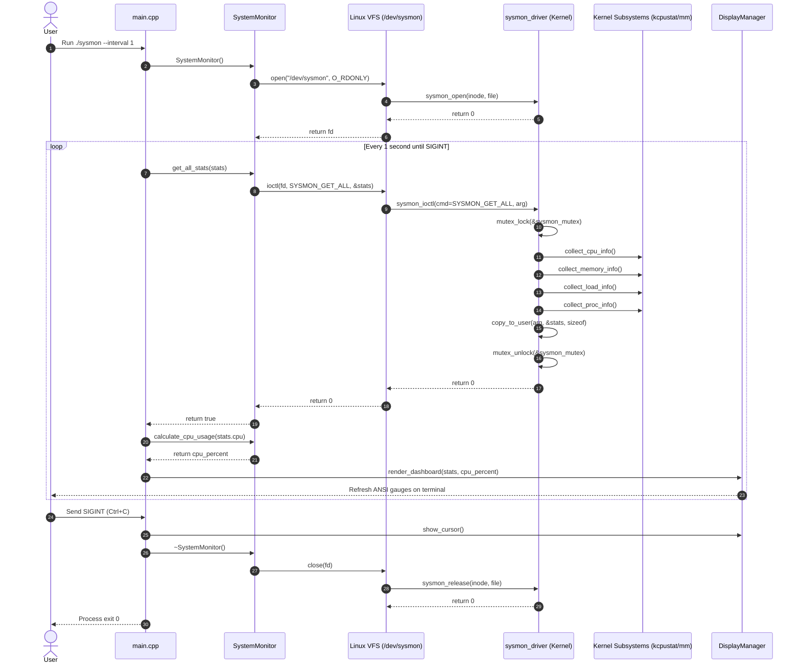
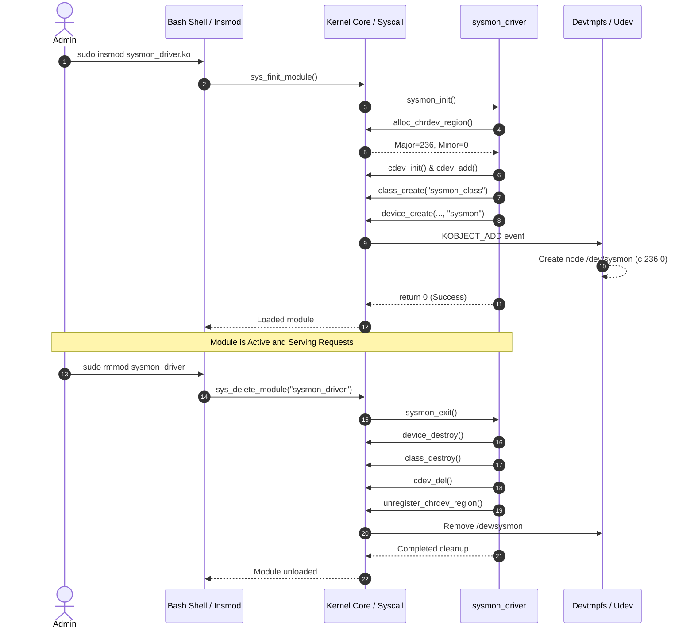

# SysMon — UML Sequence Diagrams

This document models the interaction timelines for device initialization, telemetry sampling, and shutdown.

---

## 1. Monitor Polling Loop Sequence

---

## 2. Kernel Module Lifecycle Sequence

