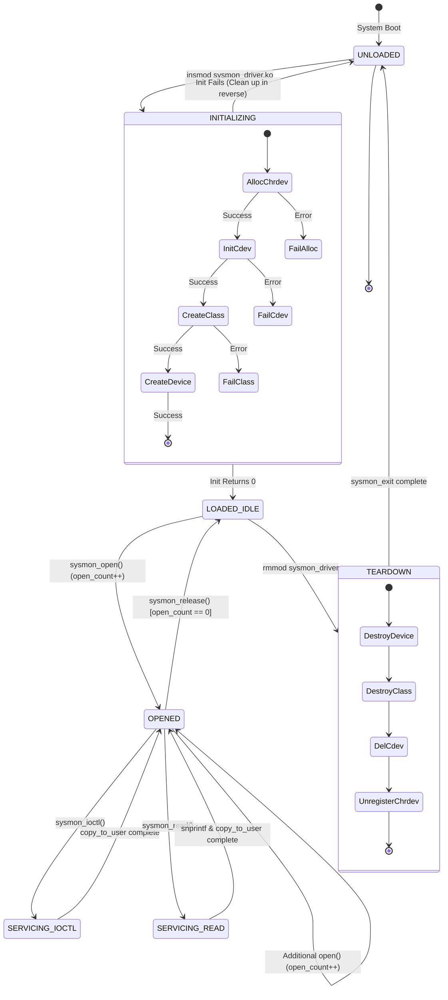
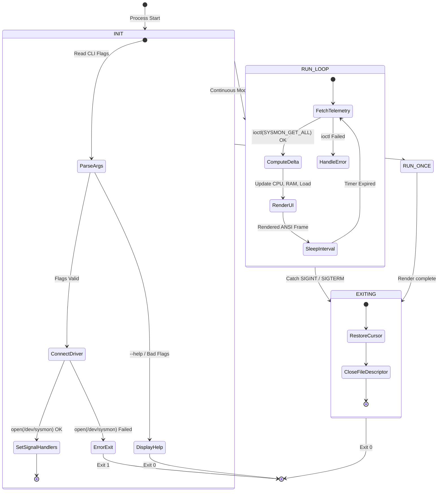

# SysMon — UML State Machine Diagrams

This document illustrates state transitions for both the Linux kernel character device driver and the user-space monitoring dashboard.

---

## 1. Character Device Driver Lifecycle State Machine

---

## 2. User-Space Application State Machine

