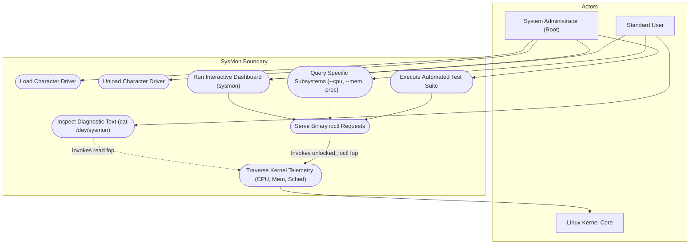

# SysMon — UML Use Case Diagram

This document models the functional interactions between primary actors and the SysMon monitoring ecosystem.

## Use Case Descriptions

| Use Case | Primary Actor | Description |
| :--- | :--- | :--- |
| **Load Character Driver** | System Administrator | Inserts `sysmon_driver.ko` into the running Linux kernel using `insmod`. Registers character major/minor numbers and creates `/dev/sysmon`. |
| **Unload Character Driver** | System Administrator | Removes `sysmon_driver` module using `rmmod`, ensuring no open file handles remain, and cleans up device nodes and classes. |
| **Inspect Diagnostic Text** | Standard User | Reads from `/dev/sysmon` using `cat` to inspect human-readable system diagnostic summaries. |
| **Run Interactive Dashboard** | User / Admin | Launches the C++ terminal UI displaying live gauges for CPU, memory, uptime, and load averages. |
| **Execute Automated Test Suite** | Developer / QA | Runs `test_ioctl` to validate all kernel entry points, error handling, and performance metrics. |
| **Serve Binary ioctl Requests** | Device Driver | Receives `ioctl` requests, collects kernel stats, and copies binary structures to user space via `copy_to_user()`. |
